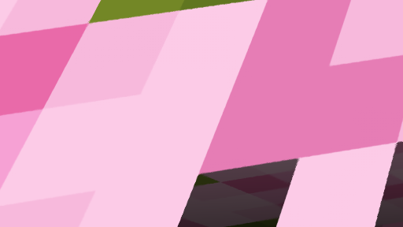

# BUG-051: temporal sampling footprints — 2026-10-16

Follow-up to the [projection correction](bugfix-lighting-sodium-temporal-20261016.md). **BUG-051 is fixed for the reported stationary-image failure.** The calibrated
0.25-output-pixel acceptance threshold remains unchanged.
Evidence: [`build/reports/bug051-residual-20261016/`](../../build/reports/bug051-residual-20261016/).
Test host: M4 Pro (14 CPU/20 GPU cores), 24 GB, macOS 27.0.1, Java 26, Minecraft 26.2,
official Sodium 0.9.2+mc26.2 and separate adapter 0.1.3/core adapter API 3. Only disposable world
copies are launched. Metal API validation is enabled for correctness tests.

## Cause and implementation

The earlier adapter correction aligned Sodium's separate projection with scene jitter, reducing
movement from 1.4100/1.4447 to 0.2597/0.2666 output pixels, but the image gate still failed.
Replaying retained linear colour, depth, motion and reactive textures isolated the remaining
history-weight feedback: recorded rejection produced approximately 0.2451/0.2199 px movement in
the cropped replay, while zero rejection produced 0.0169/0.0091. This ablation is diagnostic;
disabling rejection is not the shipped solution and cropped replay is not gameplay acceptance.

Two sampling mismatches remained in `native/src/metalmod_temporal_frame.mm`:

1. The old previous-depth lookup linearly interpolated unrelated surfaces at silhouettes. Its
   interpolated value could match neither real surface, so a stationary raster edge was treated
   as disocclusion. The corrected check requires a real, finite, positive sample in the 2×2
   bilinear footprint to meet the existing reversed-Z tolerance. An all-zero or wholly incompatible
   footprint still rejects. Object-pose candidate depth checks use the same real-surface criterion.
2. Pointwise squared colour differences confused the expected sampling variation of sharp texel
   edges with changed appearance. For jittered static geometry only, the corrected comparison
   bounds sampling variation by the current/previous five-sample local colour ranges. It measures
   disagreement outside either range, using both RGB and linear luminance/chroma bounds so a new
   bright colour cannot be accepted merely because it falls inside independent RGB minima/maxima.
   Errors are converted back to RGB units before the unchanged acceptance/rejection thresholds.

The original pointwise patch metric remains for independent-object identity/pose refinement and
for no-jitter comparisons. Static motion remains camera reprojection; the appearance bounds never invent motion.
A zero reactive mask requests MetalFX normal behavior; it does not force the scaler to accept
history. The SDK documents that MetalFX still performs its normal temporal evaluation.
Unknown/overlapping objects, incompatible/missing depth, sky, reset policy and explicit raster/
changed-light rejection retain their roles. MetalFX receives the same jitter sign/amplitude;
exposure, formats, hand/HUD composition, configuration defaults and ABI layouts are unchanged.

Neighbourhood bounds express sampling uncertainty; changes within the local palette can still
use MetalFX's normal history behavior. This is not a claim that every animated material is fully
classified. General motion/animation/release quality remains a broader Phase 7 acceptance item.

## Regressions and causal checks

A new native fixture reproduces two failures before the native change, with all existing tests
otherwise passing: compatible depth at a surface boundary incorrectly rejected history, and a
stationary sharp edge crossing the raster sampling phase incorrectly rejected history.
Both pass after the change. Additional checks require rejection of real opaque colour changes,
new luminance inside an old RGB box, wholly incompatible depth, all-sky previous footprints even
for near-zero current depth, and explicit transient coverage. Existing camera/root/pose motion,
unknown/ambiguous objects, native hand, depth/orientation and Gaussian static-image tests pass.

Replay experiments retain original/recomputed masks, symmetric interpolation, confidence-only
changes and isolated depth/appearance ablations. Neither threshold tuning nor a simple filtered
comparison was selected. The combined real-depth/neighbourhood replay measured 0.1223/0.1106 px;
full copied-world results, rather than that proxy, determine acceptance.

This is one unmodified readback frame, for scene identification. Stability acceptance uses the
complete 16-image sequences and calibration controls, not this screenshot alone.

## Verification

All five offline gates pass: **934 native checks**, **87 static + 9 post shaders**, lighting-enabled
inventory, core render check and all standalone tests. Logs:
[`verification-20261016-211929-702695`](../../build/reports/verification-20261016-211929-702695/result.txt).

Every final static sequence contains 16 unique phases and passes one-pixel calibration controls.
The image analyzer and its 0.25-pixel threshold are unchanged. Output is 3842×2162 after odd resize,
with the same 512×288 opaque foliage ROI; only the selected reduced-scene strength changes.

| Final static run | X range, output px | Y range, output px | Verdict |
|---|---:|---:|---|
| Sodium, strength 50 | 0.1564 | 0.1786 | PASS |
| Sodium, strength 25 | 0.0885 | 0.1125 | PASS |
| Sodium, strength 33 | 0.1114 | 0.1170 | PASS |
| Vanilla, strength 50 | 0.0316 | 0.0155 | PASS |
| Sodium lifecycle, strength 50 (repeat) | 0.1467 | 0.1720 | PASS |
| Vanilla lifecycle, strength 50 (repeat) | 0.0346 | 0.0160 | PASS |

The initial RGB-only candidate also passed strength 50 at 0.1534/0.1792, then the final build added
luminance/chroma bounds and its regression. It is retained separately and is not counted as a
second final-artifact repeat. Final lifecycle runs include another independent static sequence.
`--skip-timing` omits six benchmark-only stages while preserving lifecycle/image/quality stages;
these runs are correctness evidence, not release FPS measurements. Static-only runs also retain
matched native/spatial/temporal quality ROIs. Source/native images and comparison sheets remain
under each output's `validation/` directory.

Sodium lifecycle passes **477 checks / 11,207 frames**, vanilla **476 checks / 11,137 frames**,
including both independent image gates. No runtime failures occur. These counts omit the
benchmark-only stages; all image and lifecycle stages remain. FG passes **186 checks**, saved-On fresh-JVM restart **15 checks**, and capped-30 delivery
**22 runtime checks** plus both native/spatial camera midpoint-pixel analyses. All eight final
launcher runs exit 0. Every test copy matches the final core/adapter hashes, embedded native
matches the build, and the production JAR contains no validation add-on. All **688 checked
normal-instance files are unchanged**; no normal installation occurred.

Final core SHA-256: `476cb4619359807235afd9e132ba49e7596ef0ebe40c567e8bab0e1a7f649d3c`.
Adapter 0.1.3 SHA-256: `f66d511b4071ccad465ffad155debabf24810c0b752b48ae168dd03c457871e6`.
The native fix is in the core; the adapter API remains 3.

[Combined verdicts](../../build/reports/bug051-residual-20261016/verification-summary.json) include
all calibrated controls, delivery checks, artifact identity and normal-instance integrity. Commands and current machine-readable
results: [`final-commands.json`](../../build/reports/bug051-residual-20261016/final-commands.json),
[`final-status.json`](../../build/reports/bug051-residual-20261016/final-status.json).

## Performance scope

A separate GPU diagnostic compares the previous and final native libraries in ABBA order.
It tiles the same retained raster inputs to 1920×1080 and reconstructs 3840×2160 with no independent
objects. Each fresh process warms 48 batches and measures 96 completed GPU batches, with no texture
readback or presentation and Metal API validation off. It measures the complete native decode/
inputs/MetalFX/encode/history batch, not isolated mask-kernel time, pipelined throughput, Java
render-thread cost, displayed FPS or input latency. Library paths and raw per-batch CSVs are saved.

This fix does not establish quality for every scene, strength, platform, shaderpack or material.
The End, multiplayer and long-duration soak limits from the original campaign remain. The normal
Minecraft installation and source save are not used as launch working directories.

Eight runs use ABBA followed by BAAB; all are retained, including high-variance runs. AC power was
confirmed. Per-run complete-batch timings (ms):

| Run | Library | Mean | Median | p95 |
|---|---|---:|---:|---:|
| 1 | old | 5.033 | 4.983 | 5.244 |
| 2 | new | 6.880 | 6.391 | 11.785 |
| 3 | new | 5.175 | 5.144 | 5.323 |
| 4 | old | 5.119 | 5.033 | 5.519 |
| 5 | new | 5.648 | 5.281 | 6.655 |
| 6 | old | 4.969 | 4.954 | 5.079 |
| 7 | old | 5.676 | 5.558 | 6.879 |
| 8 | new | 5.184 | 5.125 | 5.584 |

All-run means are **5.199 ms before / 5.722 ms after
(+10.0%)**. The median of per-run medians changes
**5.008 → 5.213 ms
(+4.1%)**. Runs overlap and show transient variance, so a precise
shader-only or gameplay cost is not established. The measured aggregate increase is a performance
follow-up, not an FPS gain. Data:
[`gpu-profile-summary.json`](../../build/reports/bug051-residual-20261016/gpu-profile-summary.json)
and all eight raw `gpu-profile-*.csv` files. The first new-library mean of 6.880 ms is retained;
no unfavorable run was silently excluded.

Possible optimization: reduce local-range ALU/register work on exactly matching patches, with a
bit-equivalence check and all existing edge/appearance regressions before accepting a fast path.
This candidate is not implemented and has no projected FPS benefit. Current quality acceptance
must not be traded for looser depth, appearance or static-image thresholds.
